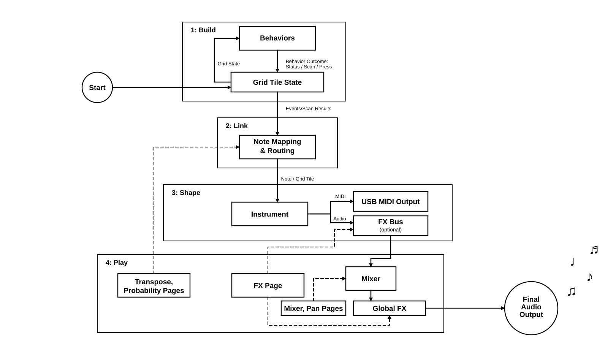

# Controls cheat sheet

Keep this beside the instrument while you learn where everything lives. It
prints on a few pages; the [printable quick reference](print/quick-reference.pdf)
is the one-sheet version.

Octessera has regular controls and a few temporary modes (Play pages, tile
assignment, the probability painter, context help). When in doubt, look at
the OLED. It always shows what the controls are acting on.

## Learn these five first

| Control | What it does |
|---|---|
| Turn *Main* | Move through menus, or change the value you're editing. |
| Click *Main* | Select, enter, edit or confirm. |
| *Back* | Leave an edit, an overlay or a menu level. |
| *Play* (*Space* in the simulator) | Start or pause. |
| Hold *Fn*, press a grid edge tile | Left column picks a layer, right column picks a Play page. Hold *Shift* + *Fn* for the other page bank. |

## Regular controls

| Control | What it does |
|---|---|
| Turn *Main* | Move through the menu. While editing a number, plain turns are coarse and *Fn* turns are fine; *Shift* and *Shift* + *Fn* turns stay coarse. |
| Click *Main* | Select a row, enter a group, start or finish an edit, or run an action. |
| *Back* | Finish the current edit, leave the current overlay, or go up one menu level. |
| *Play* | Play or pause. In the sample browser it previews the highlighted sample instead. |
| *Shift* + *Play* | Stop and return to the start. Under external MIDI sync it instead arms a one-off resync at the next bar; playback carries on, then the transport snaps back to its origin. |
| *Fn* + *Play* | Stop and return to the start, always, even in the sample browser or under external sync. |
| *Fn* + turn *Main* right (not editing) | While paused or stopped, step the active layer's world forward one generation. Left does nothing; while playing, the OLED asks you to pause first. |
| *Shift* + *Fn* + *Play* | Does nothing. |
| *Shift* + *Back* | Clear and re-initialize the active layer. Very useful, and you have to mean it. While editing text, it deletes a character instead. |
| *Shift* + *Fn* + click *Main* | Context help for the highlighted row. |
| *Fn* + click *Main* | Open the [Aux mappings](#aux-mappings-modal) list. |

Stopping (and an accepted MIDI Start or resync) rewinds the transport, the
scan cursor, Pattern phase and the Looper's playback position. It keeps your
evolved worlds, your settings and the recorded loop. Pause and continue picks
up exactly where it left off.

**Curved steps.** Times, frequencies and decay amounts take smaller steps where
small changes matter. Millisecond times move 1 ms per detent below 20 ms, 5 ms
up to 100 ms, 25 ms up to a second and 100 ms beyond (with *Fn*, one notch
finer). Effect frequencies, rates and Q move about a quarter-tone per detent.
Reverb Decay and delay Feedback slow down near the top so long tails stay
settable. Instrument filter cutoffs keep their ordinary steps, and everything
else moves in plain even steps.

## USB-host keyboard

A computer keyboard plugged into the instrument (or a paired
[Bluetooth keyboard](bluetooth.md)) acts as a second set of controls, not a
typing machine. The [desktop simulator](desktop-simulator.md) uses the same
map.

Keys count by where they sit, not by what's printed on them. A German,
French, US, Dvorak or Cyrillic layout all put the same tiles under the same
fingers, so the tables show both the German and the US keycaps for each
spot.

| Key (German / US keycap) | Instrument control |
|---|---|
| *←* / *↑* and *→* / *↓* | Turn *Main* left / right. |
| *Enter* or the number pad's *Enter* | Click *Main*. |
| *1* / *2* / *3* | *Aux 1* left / click / right. |
| *Q* / *W* / *E* | *Aux 2* left / click / right. |
| *A* / *S* / *D* | *Aux 3* left / click / right. |
| *Backspace* / *Escape* | *Back*. |
| *Space* | *Play*. (The letter *S* is the *Aux 3* click.) |
| *Shift* | *Shift*. |
| *Control* (*Strg*) | *Fn*. |
| Left *Alt* (hold) | Grid keys play the top half instead of the bottom. |

**The grid on your keyboard.** Four rows of eight keys are the bottom half of
the grid; hold the left *Alt* and the same keys are the top half. Left to
right is grid column 1 to 8:

| Keys (German) | Keys (US) | Grid row | With left *Alt* |
|---|---|---|---|
| *4 5 6 7 8 9 0 ß* | *4 5 6 7 8 9 0 -* | 4 | 8 (top) |
| *R T Z U I O P Ü* | *R T Y U I O P [* | 3 | 7 |
| *F G H J K L Ö Ä* | *F G H J K L ; '* | 2 | 6 |
| *C V B N M , . -* | *C V B N M , . /* | 1 (bottom) | 5 |

A key is a tile: press it, hold it, let go, just like the NeoTrellis button.
*Shift*, *Control* or both plus a grid key work like the modifiers with a
tile, so *Control* with *4*, *R*, *F* or *C* (the left grid column) picks a
layer.
Letting go releases the tile you pressed, even if *Alt* changed meanwhile.
Holding a grid key doesn't repeat. *Y* and *X* (US *Z* and *X*), the German
*<* key and the right *Alt* (*AltGr*) do nothing.

Two conditions apply. `System > Display > HDMI Video > Mode` has to be a
graphical mode, not `Terminal` (the shipped default `live-grid` is fine). A
wired keyboard on the Raspberry also needs `System > Connections > USB Role`
set to Host; on the Orange, use the one-dot USB-C port. Only the first keyboard picked up gets the controls. The
[USB roles page](hardware/usb-roles.md) has the wiring side.

## Context help

Highlight a row with *Main*, hold *Shift* and *Fn*, then click *Main*. Turn
*Main* to scroll; click *Main* or press *Back* to close it.

Help belongs to the highlighted row, whether it's a parameter, action,
selector or mode. For another row, close help, highlight that row and ask
again. Hold *Shift*, *Fn* or both for more than a second and the OLED reminds
you what they do. `System > Basic Help` shows the core shortcuts in one place.

## Aux mappings modal

| Control | What it does |
|---|---|
| *Fn* + click *Main* | Open the list from anywhere, stopped or playing. It stays open after you let go of *Fn*. |
| Turn *Main* | Scroll. |
| Click *Main*, *Fn* + click *Main*, or *Back* | Close. |

It shows all three Aux encoders' turn and click mappings in the normal and
*Shift* banks, with `-` for unbound. Aux turns and clicks do nothing while it's
open, so you can't change anything by accident.

## Aux encoders and auto-map

Each Aux encoder has a **turn** binding (changes a value) and a **click**
binding (runs an action). Auto-map gives any turn or click you haven't bound
yourself the most useful control of whatever menu area you're in. Your own
bindings win, unless you set `System > Display > Aux Prio.` to *Auto*: then
the page's auto-map wins and your bindings fill in wherever it has nothing.
`System > Display > Auto Map` switches auto-map off.

- Bind your own: highlight a row and press *Fn* + click that Aux encoder. A
  value becomes its turn binding, an action its click binding.
- *Shift* + *Fn* + click an Aux encoder binds into the *Shift* bank instead.
  Hold *Shift* while turning or clicking to use it. Auto-map puts the three
  most-used controls on the plain encoders and the next three on the *Shift*
  bank.
- On numbers, a plain Aux turn is coarse and *Fn* + turn is fine; the same
  goes for *Shift* and *Shift* + *Fn* in the *Shift* bank. Lists and switches
  move one option per detent.

OLED markers:

| Marker | Meaning |
|---|---|
| A little cap left of a row | An Aux encoder turns or clicks this row, bound by you or by auto-map. One pip is *Aux 1*, two pips *Aux 2*, three *Aux 3*. |
| A bar under the cap | It's the *Shift* bank: hold *Shift* while you turn or click that encoder. |
| Bottom left of the screen | One cap per Aux encoder with what it does on this page: the turn label, and the click label with a `!` (the click sits above the turn when there are both). Hold *Shift* to see the *Shift* bank. Switch off `System > Display > Auto Hints` or `Manual Hints` to drop the auto-mapped or your own hints there; the row caps stay. |
| `not active` toast | The binding still exists, but its target is hidden or inactive right now. |

## Grid navigation

| Control | What it does |
|---|---|
| Hold *Fn* | Preview: the left column shows layers (cyan for the current one, green for layers with a behavior, dim for empty ones; with a Play page open, every layer with a behavior shows cyan). The right column shows the technical Play pages in dim yellow with the open one in green. Hold *Shift* + *Fn* to see the musical ones. |
| *Fn* + left column | Jump to that layer (bottom row is Layer 1). This also closes any open Play page. |
| *Fn* + right column | Open a technical Play page. From the bottom: Mix, Pan, Route, Tempo, LFO, Faders. |
| *Shift* + *Fn* + right column | Open a musical Play page. From the bottom: FX, XY, Transpose, Rate, Trigger Gate. |
| *Shift* + *Fn* + left column | Mute or unmute that layer's triggers without switching to it. Muting releases its held notes. |
| *Fn* + click an Aux encoder | Bind the highlighted value or action to that encoder. |

The Play pages themselves are explained in
[Behaviors and Play pages](behaviors-and-play.md#play-pages).

## Assignment modes

These take over the grid until you press *Back*. In all of them, *Shift* +
tile applies to the whole row and *Shift* + *Fn* + tile to the whole column.

| Mode | Opened from | What a press does |
|---|---|---|
| Sample assignment | `Sampler > Assign` | Stamps the sample slot plus Tile Tune, Fine and Level. High, Medium and Low tiles light magenta, yellow and green; Base tiles pale white; other slots dim gray. |
| Drum assignment | `Drum > Assign` | Stamps the selected voice plus the Tile values. The selected voice's tiles light bright white, other voices dim white. |
| Trigger probability map | `Link > Lx > Trigger Prob. > Map Prob Grid` | Cycles the tile through zero, low, high and full (dark, magenta, yellow, green). |
| Play FX mapping | `Play > FX > Map to Grid` | Stores the current momentary effect on the tile. |

When stamping, pressing a tile that already holds exactly that stamp clears it;
anything else gets overwritten. More in
[Sound and Link](sound-and-link.md#drum-and-sampler-tiles-are-stamps).

## Tile-to-audio flow

Scanning is optional. A layer that isn't scanning still plays from tile events
like `activate`, or directly from your presses in `keys` and `looper`.

## Sample browser

`..` goes up a folder, `[folder]` opens one, the other rows are samples, and
`(empty)` means there's nothing here. *Play* previews the highlighted sample,
and a little play triangle sits on its row for as long as the preview is
actually sounding. Handy for whisper-quiet files or ones with a slow fade-in,
where your ears alone might swear nothing happened.
Long names clip or scroll rather than run into other text. The sampler's
`S1: kick.wav >` row opens the browser right in that file's folder, with a
little `▸` pointing at the file you have loaded.

## Status on the OLED

| Where | What it tells you |
|---|---|
| Top left | Where you are in the menu, in the area's color, with a line of the same color under it. Long paths lose their parents first (`../`), never the page you're on. |
| Top right, three bars | How hard the audio engine worked over the last second. One green bar is relaxed, two yellow bars are getting busy, three red bars mean you've reached *CPU Warn %* (`System > Audio > Engine`). On the desktop it shows the simulator's own audio load. |
| Left of the bars | A green tick while a save happens, and a red square when the audio engine missed a deadline (it stays a few seconds, so you can catch it). |
| Red `CLIP` before the icons | The output was too loud and got squashed flat at full scale. It stays two seconds after the last clipped bit, and the menu path steps aside for it. Turn down `System > Audio > Master Vol` or the instruments on the Mix page. |
| Little discs left of a row | That row is on an Aux encoder right now: one, two or three pips for Aux 1-3, and a bar underneath for the Shift layer. |
| How a row reads | A value on the right (`Step Rate  1/8`) changes when you click and turn. `Beh.: life >` is picked from a list: click to open it. A plain `>` opens a page, and `!` does something right away. |
| `▸` in a list | The entry you have picked now, and the folder it lives in. Lists open with the cursor right there. |
| Bars instead of numbers | `System > Display > Num Style` is on `bar`. Switch it to `numbers` if you'd rather read digits. |
| Letters look different | `System > Display > Main Font` and `Small Font` pick my redrawn glyphs (`Octessera`) or the original fonts (`Original`). Flip them if you want the old look back. |
| Watching one sound | `Signal` on an instrument, an FX bus or `Global FX` fills the screen with that sound, drawn live while the transport plays. Click Main to flip between the waveform, the frequency bars and the waterfall; Back drops you on the page you came from. |
| A wiggly line on the home page | That's the master output, drawn live while the transport plays. When it's quiet it lies flat and dim. `System > Display > Home Visual` swaps it for frequency bars (`spectrum`) or a scrolling `waterfall`, or turns it off if you'd rather have the old calm home page. |
| Bottom left | What Aux 1-3 do on this page: the turn, and a click with a `!`. Hold *Shift* to peek at the Shift layer. |
| Bottom right, red disc | A recording is running. It breathes once a second so you don't forget it's on. |
| Bottom right, icon | Play, pause or stop. It blinks yellow on beats and green on bar starts. |
| Bottom right, diamond | Lights for each event, stays bright while events keep coming, and fades out about half a second after the last one. |

Toasts cover the Aux hints for a moment and leave the recording disc, the
transport icon and the diamond alone.

## Tiny survival notes

- The OLED is the truth. If the grid does something odd, you're probably on a
  Play page or in an assignment mode. Check the OLED, then press *Back* or
  jump away with *Fn*.
- Help is *Shift* + *Fn* + click *Main*. I made it a three-finger combo so you
  won't open it by accident (you also won't remember it the first week, which
  is why it pops up right after the startup screen).
- If a behavior gets too busy, try probability before you delete the pattern.
  Let it breathe.
