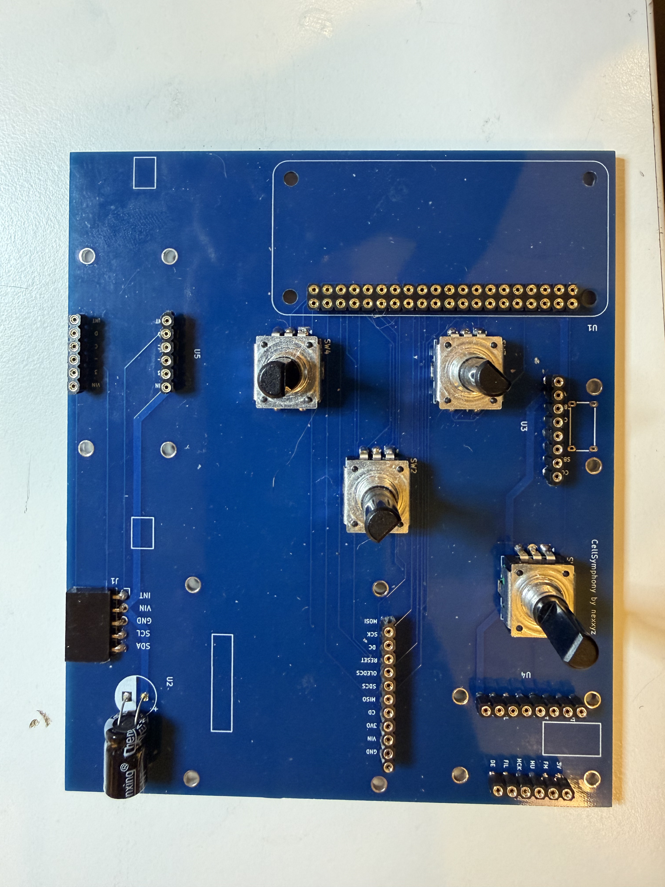
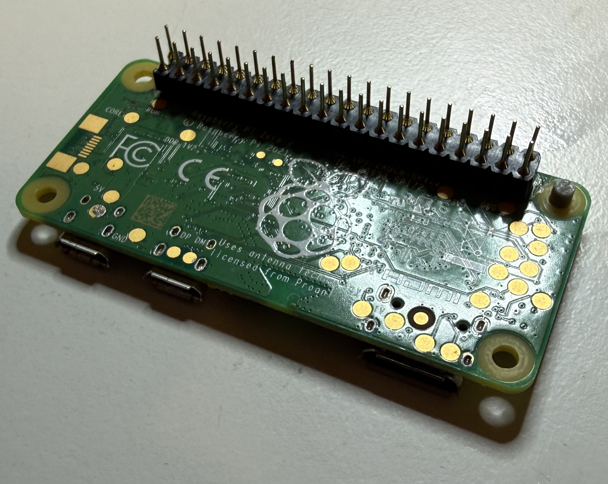
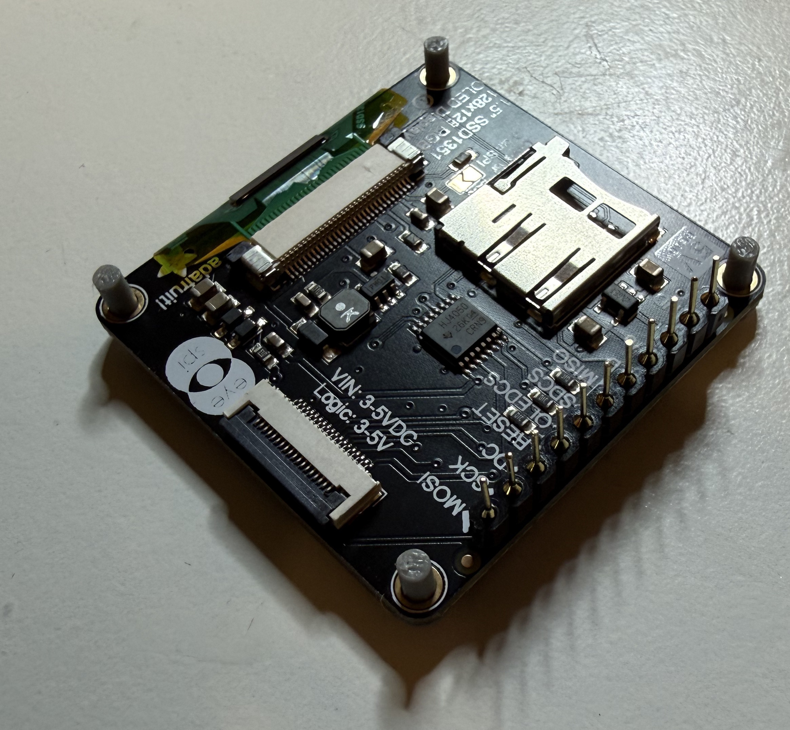
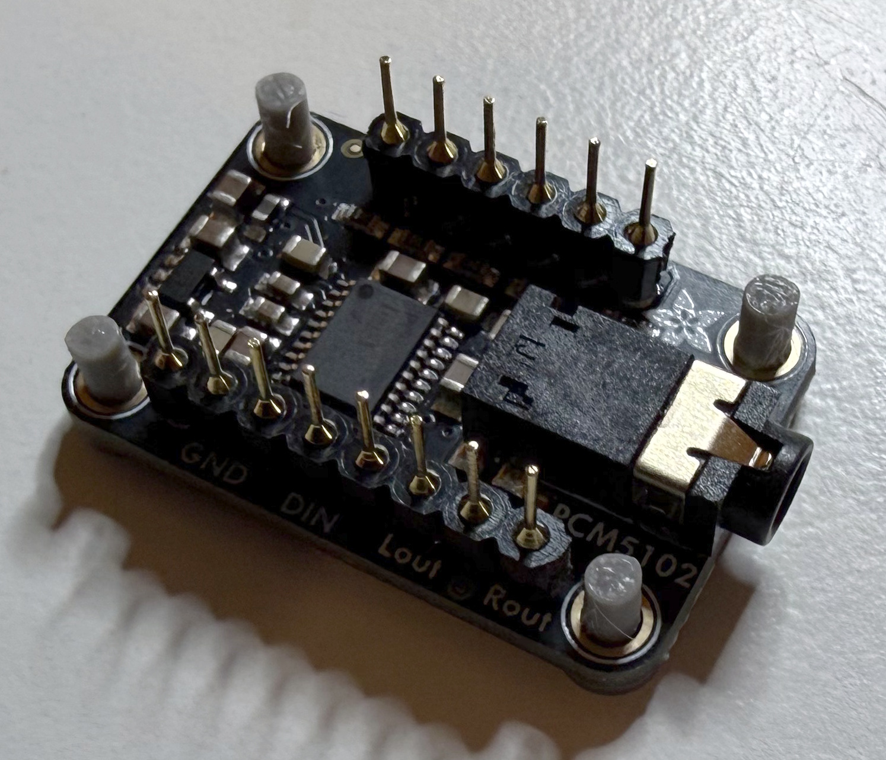
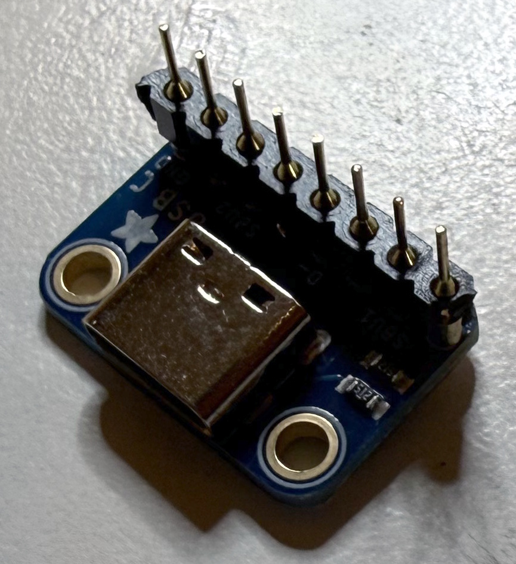

# Octessera hardware assembly manual

Welcome to the workbench. By the end of this manual you will have a little box
of algorithmic musical worlds: an 8x8 light-up grid, four keys, four knobs, a
tiny OLED and a DAC, all driven by a Raspberry Pi Zero 2 W or an Orange Pi Zero
2W.

The build goes in this order, and the order matters:

1. [Pick a board and read the safety page](#1-safety-and-board-choice).
2. [Gather the parts and tools](#2-parts-and-tools).
3. [Solder the PCB, the grid and the NeoKey](#3-soldering).
4. [Put it together on the bench, case still open](#4-open-assembly).
5. [Flash the card and boot it while everything is still reachable](#5-flash-and-setup).
6. [Close it up in the enclosure](#6-enclosure).
7. [Do the final check](#7-final-check).

Keep the assembly open until [flash and first boot](flash-and-first-boot.md) has
passed. Finding a cold solder joint is much more fun before eight screws and a
lid are in the way.

## 1. Safety and board choice

Choose one compute board before ordering parts:

- Raspberry Pi Zero 2 W
- Orange Pi Zero 2W

Everything else is shared, except two things: each board needs **its own
image** (see [flash and first boot](flash-and-first-boot.md)) and **its own
matching enclosure top** (see [enclosure](enclosure.md)).

Read [safety and power](safety-and-power.md) before you handle power, a host
cable or the enclosure. The short version: power the finished instrument only
through the enclosure's USB-C power breakout, never through the Raspberry Pi's
own micro-USB power connector.

## 2. Parts and tools

### PCB and electronics

| Qty | Item | Part | Notes |
|---:|---|---|---|
| 1 | Custom PCB | Fabricate from [`../../hardware/pcb/gerber/gerber.zip`](../../hardware/pcb/gerber/gerber.zip) | Order as a two-layer PCB unless the Gerber notes say otherwise. |
| 4 | NeoTrellis 4x4 driver PCB | [Adafruit `3954`](https://www.adafruit.com/product/3954), Mouser `485-3954` | Four of them make the 8x8 grid. |
| 4 | Silicone 4x4 keypad | [Adafruit `1611`](https://www.adafruit.com/product/1611), Mouser `485-1611` | One per NeoTrellis board. |
| 1 | NeoKey 1x4 QT | [Adafruit `4980`](https://www.adafruit.com/product/4980), Mouser `485-4980` | Holds the four Cherry MX keys. |
| 1 | Compute board | [Raspberry Pi Zero 2 W](https://www.raspberrypi.com/products/raspberry-pi-zero-2-w/) or Orange Pi Zero 2W | Choose one. |
| 1 | Wi-Fi antenna (Orange Pi only, optional) | Orange Pi Zero 2W-compatible antenna | Connect it before final assembly. Fix it with non-conductive tape on a free PCB area where it cannot cover pads, touch exposed contacts, get pinched or strain its connector. |
| 1 | SSD1351 OLED breakout with microSD holder | [Adafruit `1431`](https://www.adafruit.com/product/1431), Mouser `485-1431` | SPI display. Its microSD slot is the optional second card (SD2). |
| 1 | PCM5102 I2S DAC | [Adafruit `6250`](https://www.adafruit.com/product/6250), Mouser `485-6250` | The 3.5mm line/headphone output. |
| 1 | USB-C power breakout | [Adafruit `4090`](https://www.adafruit.com/product/4090), Mouser `485-4090` | The instrument's only power input. |
| 4 | Rotary encoder with push switch | [RS `781-6811`](https://at.rs-online.com/web/p/mechanische-drehgeber/7816811), Bourns `PEC12R-4225F-S0024` | Fitted at `SW1` to `SW4`. |
| 1 | Polarized capacitor | [`470uF`, 16V, radial, about 8x12mm](https://de.aliexpress.com/item/1005010415990713.html) | `C1`, footprint `CP_Radial_D8.0mm_P3.50mm`. Any 470uF polarized radial capacitor with 3.5mm lead pitch and a rating above 5V will do. |
| 1 | 5V TVS diode | `SA5.0A`, axial DO-15 | `D1`, footprint `Diode_THT:D_DO-15_P10.16mm_Horizontal`. Required. |
| 1 | 1x5 right-angle male header, 2.54mm pitch | Any standard breakaway right-angle header | `J1`, the NeoTrellis connector. |
| 1 | 5-wire female-to-female Dupont cable, about 10cm | Any 2.54mm female-to-female jumper set | Five adjacent leads for the NeoTrellis array. |
| 25 pins | Straight male header, 2.54mm pitch | Any standard breakaway header strip | 20 pins join the four NeoTrellis boards; 5 make the connection point on the upper-left board. |
| several | Low-profile female header/socket strips, 2.54mm pitch | [Round-pin socket strip](https://de.aliexpress.com/item/1005006673257121.html) or [round-pin socket strip](https://de.aliexpress.com/item/4001122376295.html) | Cut to length for the compute board, OLED, DAC, power breakout and NeoKey. Check the socket height before ordering. |
| 4 | Cherry MX-compatible key switches | [Cherry MX Black](https://www.amazon.de/-/en/CHERRY-Mechanical-Keyboard-Switches-without/dp/B0CBS4HJJR?th=1) or any MX-compatible switch | Fitted through the enclosure top into the NeoKey, after the case is closed. |
| 1 | MicroSD card for the compute board | 16GB or larger recommended | Holds the board image. Raspberry and Orange images are different. |
| 1 | USB-C power supply | Dedicated regulated 5V/4A supply for Raspberry Pi 4-class boards | A GeeekPi 20W 5V/4A supply works. Connect it only to the USB-C breakout. |
| 1 | USB data cable and adapter (optional) | Depends on what you want to connect | Read [USB roles](usb-roles.md) first. |
| 1 | Headphones, speaker or mixer | 3.5mm audio cable | So you can hear what the worlds are up to. |

### 3D-printed and mechanical parts

The enclosure is held together by printed standoffs and push-in top pins, plus
eight heat-set inserts and screws that join the two shells. The fits are snug
on purpose, so calibrate your printer or print a test piece before committing
to the full set.

The STEP, STL, single-material 3MF and multicolor 3MF folders each hold the
same complete 18-part set. The multicolor set is 12 two-material designs plus
six one-material support pieces. The set also contains the [protective
case](protective-case.md) and two friction-insert parts
(`friction_insert_expanding_plug_flat_sides`,
`friction_insert_spreading_pin_headed`); this manual uses heat-set inserts
instead and does not need them.

| Qty | Item | File/spec | Notes |
|---:|---|---|---|
| 1 | Enclosure top | Board-specific `../../hardware/enclosure/stl/case_top_two_level_cadquery_<board>.stl`, the matching single-material `../../hardware/enclosure/3mf-single-material/case_top_two_level_cadquery_<board>.3mf`, or the branded multicolor `../../hardware/enclosure/3mf-multicolor/case_top_two_level_<board>_multicolor.3mf` | `<board>` is `raspberry-pi-zero-2w` or `orange-pi-zero-2w`. Check the fit against your actual board before the final print. |
| 1 | Enclosure bottom | `../../hardware/enclosure/stl/case_bottom_plate_cadquery.stl` | Bottom plate with guide walls and screw holes. |
| 1 | Main encoder knob | `../../hardware/enclosure/stl/encoder_cap_main_knurled_dots.stl`, `../../hardware/enclosure/3mf-single-material/encoder_cap_main_knurled_dots.3mf`, or `../../hardware/enclosure/3mf-multicolor/encoder_cap_main_knurled_dots_multicolor_flush.3mf` | The multicolor version has a dot-ring marking. |
| 3 | Aux encoder knobs | `../../hardware/enclosure/stl/encoder_cap_aux*_ribbed_dot*.stl`, the matching `../../hardware/enclosure/3mf-single-material/encoder_cap_aux*.3mf`, or `../../hardware/enclosure/3mf-multicolor/encoder_cap_aux*_multicolor_flush.3mf` | Aux 1, 2 and 3 caps, marked with one, two and three dots. |
| 4 | MX keycaps | `../../hardware/enclosure/stl/mx_keycap_*.stl`, the matching `../../hardware/enclosure/3mf-single-material/mx_keycap_*.3mf`, the matching `../../hardware/enclosure/3mf-multicolor/mx_keycap_*_multicolor_flush.3mf`, or any MX-stem keycap | Back, Play, Shift and Fn/layer. Transparent filament for the cap body lets the key LEDs shine through. |
| 8 | 9.5mm standoff pillar | `../../hardware/enclosure/stl/standoff_pillar_9_5mm.stl` or `../../hardware/enclosure/3mf-single-material/standoff_pillar_9_5mm.3mf`, or compatible stackable PCB standoffs | Under the OLED and the DAC. |
| 10 | 10mm standoff pillar | `../../hardware/enclosure/stl/standoff_pillar_10mm.stl` or `../../hardware/enclosure/3mf-single-material/standoff_pillar_10mm.3mf`, or compatible stackable PCB standoffs | Under the compute board, power breakout and NeoKey. The NeoTrellis array sits on pillars built into the bottom instead. |
| 26 | Standoff top pin | `../../hardware/enclosure/stl/standoff_top_pin_thin_base.stl` or `../../hardware/enclosure/3mf-single-material/standoff_top_pin_thin_base.3mf`, or compatible stackable PCB standoff pins | 4 compute board + 4 DAC + 4 OLED + 4 NeoKey + 2 power + 8 NeoTrellis = 26. |
| 8 | Heat-set insert | M3x6x5, such as the M3 size in this [heat-set insert kit](https://de.aliexpress.com/item/1005012199553197.html) | Goes into the empty top from underneath; the smooth lead-in end locates in the `4.6mm` pilot hole. |
| 8 | Screws | M3x8 socket-head cap screw, DIN 912 / ISO 4762 style | Fitted from the bottom. The four corner counterbores are `5.8mm` wide (the others `6.4mm`), so the head must be no wider than `5.8mm`; a standard DIN 912 M3 head is `5.5mm`. |
| 8 | Rubber feet or screw-hole plugs | Small adhesive feet | Optional. Covers the screw holes and stops the instrument wandering off the table. |

### Tools and consumables

- Soldering iron and solder
- Flush cutters
- Multimeter
- BalenaEtcher or another image flasher
- Nice to have: heat-set insert tool, small screwdriver, pliers, tweezers,
  helping hands and a magnifier

## 3. Soldering

Before you heat the iron, lay out the PCB and every module, and mark which side
of each module faces which way in the finished instrument. Headers soldered on
the wrong side are miserable to undo, so this five-minute step pays for itself.

Work with the instrument unplugged, and remember the static advice in [safety
and power](safety-and-power.md#static-heat-and-hands).

### Main PCB

1. Solder the four rotary encoders into `SW1` to `SW4`.
2. Solder the low-profile sockets for the compute board, OLED, DAC, USB-C power
   breakout and NeoKey.
3. Solder the 1x5 right-angle male header at `J1`. Point it toward the cable
   path and check the connector marking on the PCB.
4. Solder `D1`, the `SA5.0A` TVS diode: **banded cathode into `K/+5V`,
   unbanded anode into `A/GND`.** Keep the body and leads clear of nearby pads
   and metal.
5. Solder `C1`, the `470uF` capacitor, **matching the PCB polarity marking.**
   You can leave the legs a little long so the capacitor can lie on its side;
   make sure the legs can't touch pads or metal.
6. Solder male pin headers onto the compute board and each plug-in module. The
   pins must point **into** the main PCB's sockets when the module sits on its
   standoffs. Do not plug the modules in yet.

This is one of my earlier boards, so its silkscreen still wears an old
project name. Trust the labels on your own PCB.

### NeoTrellis and NeoKey

The four NeoTrellis boards join up into one 8x8 grid. The tricky part is the
address jumpers, because you set them from the back, where left and right swap.

1. Lay the four boards out as upper-left, upper-right, lower-left and
   lower-right **as seen from the play surface**.
2. Turn the whole arrangement over as one piece. From here on, positions are as
   seen **from the bottom**.
3. Solder 20 straight male header pins between neighbouring boards to join them.
4. Add 5 straight male header pins on the left side of the upper-left board.
   This is where the cable to `J1` connects.
5. Still looking at the bottom, solder the address jumpers:

   | Position (seen from the bottom) | Jumpers | Address |
   |---|---|---:|
   | upper left | A0 | `0x2F` |
   | upper right | none | `0x2E` |
   | lower left | A0 + A1 | `0x31` |
   | lower right | A1 | `0x30` |

   Seen from the play surface, that works out as upper-left `0x2E`, upper-right
   `0x2F`, lower-left `0x30` and lower-right `0x31`. See the [NeoTrellis
   address jumper photo](images/assembly/neotrellis-address-jumpers.jpg).

6. On the NeoKey, solder jumpers A0, A1, A2 and A3. Its address is `0x3F`. See
   the [NeoKey address jumper photo](images/assembly/neokey-address-jumpers.jpg).

## 4. Open assembly

Now put it together on the bench, case still off.

1. Plug the compute board, OLED, DAC, USB-C power breakout and NeoKey into their
   sockets.
2. Connect `J1` on the main PCB to the five-pin header on the upper-left
   NeoTrellis board with five female-to-female Dupont leads. Match `INT`,
   `VIN`, `GND`, `SCL` and `SDA` by their labels, using the [J1 pin
   reference](../../hardware/docs/pinout-and-connections.md#other-connections).
   Do not trust cable colours or assume the pin order is the same at both ends.
3. Check orientation before power: on the NeoKey and the NeoTrellis connector,
   `INT` must be on the south side.
4. If your build has the optional Orange Pi antenna, connect it now and fix it
   where it cannot touch contacts, cover pads or get pinched.
5. Connect headphones, a speaker or a mixer to the DAC's audio output.
6. Leave the case open and continue with [flash and first
   boot](flash-and-first-boot.md).

## 5. Flash and setup

Work through [flash and first boot](flash-and-first-boot.md) now, with
everything still reachable. Before you close anything, check:

- [ ] All four encoders turn and click.
- [ ] The OLED is readable.
- [ ] The NeoTrellis cable is seated at both ends, with the five signals matched
      as in [open assembly](#4-open-assembly).

If any of these fails, do not close the case. Fix it while you can still reach
it.

The full grid and the synth audio test belong in the [final
check](#7-final-check), once the silicone keys and NeoKey switches are fitted.
If you can safely test either earlier, go ahead.

Leave the NeoKey switches out for now. The enclosure top guides their pins and
holds them by friction; without it, a bare switch is easy to push in crooked,
bending a pin or damaging the NeoKey. If you have spares and feel lucky, you can
test bare switches, but I recommend waiting for the top (there is an optional
early test in step 8 below).

## 6. Enclosure

Before you start:

1. Power off and unplug every cable.
2. **Take out the compute board's boot microSD card and the OLED microSD
   card.** They stick out, catch on the case and break. Don't ask me how I
   found that out. Twice.
3. Unplug the modules from their sockets.

Then build it up:

1. Put the enclosure bottom on the bench. Seat the main PCB over the smaller
   built-in pillars on the west half, inside its locating rails.
2. Put the joined NeoTrellis array on the taller built-in pillars on the east
   half. Route its five-wire cable through the gap in the left rail and connect
   it to `J1` if you unplugged it, matching the five signals as in [open
   assembly](#4-open-assembly). Keep the cable clear of posts and pin holes.
3. Fix the NeoTrellis array to the taller pillars with eight top pins. Use
   gentle pressure. If a pin is loose, gently squeeze its ball end with pliers
   or print a new one rather than crushing it.
4. Lay one silicone 4x4 keypad on each NeoTrellis board. Seat all four flat to
   make the 8x8 playing surface.
5. Push the 18 loose standoffs through the main PCB mounting holes into the
   smaller west-side pillars: eight 9.5mm standoffs for the OLED and DAC, and
   ten 10mm standoffs for the compute board, USB-C power breakout and NeoKey.
6. Set the modules on those standoffs, guiding their header pins into the
   matching sockets. Do not bend or force the pins.
7. Push the remaining 18 top pins through the modules' mounting holes into the
   loose standoffs. Check that every module sits flat and its header is fully
   seated.
8. Heat-set the eight M3 inserts into the wall pillars of the **empty top**,
   from its underside, and let it cool. Then lower the top onto the assembly
   west side first, so the ports find their openings, and then the east side.
   Do not force it.

   *Optional early key test:* with the top seated but not screwed down, push
   the NeoKey switches through the top's openings into the breakout. Only if
   the boot card slot is reachable without moving the top, and you can power
   the assembly without pinching a cable, put the card back, power up and try
   all four keys. Then power off, unplug, and with the top and NeoKey supported,
   pull the switches straight back out through the same holes. Take the card out
   again before turning the case over. If any of that is awkward, skip it and
   use the final check instead.

9. Turn the device over carefully and fasten the bottom to the top with the
   eight M3 screws from underneath. Tighten gently. Add the optional rubber feet
   or screw-hole plugs.
10. Press the four encoder caps onto their shafts. Then fit the four Cherry MX
    switches into the NeoKey through the top openings, and press the keycaps on.
    The top guides the switch pins and holds the switches by friction.

If the top does not sit flat, something is in the way. Find it rather than
tightening harder.

## 7. Final check

1. Put the compute board's boot microSD card back in, and the OLED microSD card
   if you use one.
2. Connect power through the enclosure's USB-C opening and wait for the boot.
3. Check that the enclosure has not blocked any control or opening. If closing
   the case disturbed a connection, open it again and repeat the
   [flash and setup checks](#5-flash-and-setup).
4. Press each of the four NeoKey keys. If one does not respond, power off and
   open the case to check its seating, rather than pushing the switch harder.
5. Press all 64 grid cells through the silicone keys, then start a synth and
   confirm that sound comes out of the DAC. If either fails, power off and open
   the case rather than leaning on the playing surface.
6. Check that the boot microSD, OLED microSD, audio, USB-C power and video
   openings are all reachable. See [enclosure](enclosure.md) for which opening
   is which.

All good? Congratulations: you now own a small herd of musical world-bubbles.
Head to the [user manual](../README.md#4-make-music) and make some noise.

If something is unclear or misbehaving, stop and check
[troubleshooting](../troubleshooting.md) before carrying on.

## Source and manufacturing references

- Gerbers: [`../../hardware/pcb/gerber/gerber.zip`](../../hardware/pcb/gerber/gerber.zip)
- Schematic: [`../../hardware/pcb/octessera.kicad_sch`](../../hardware/pcb/octessera.kicad_sch)
- PCB layout: [`../../hardware/pcb/octessera.kicad_pcb`](../../hardware/pcb/octessera.kicad_pcb)
- Pin and bus reference: [`../../hardware/docs/pinout-and-connections.md`](../../hardware/docs/pinout-and-connections.md)
- Enclosure: [`enclosure.md`](enclosure.md)
- Standoff attribution: [Stackable PCB Standoff by theduckom](https://www.printables.com/model/163087-stackable-pcb-standoff), licensed under [CC BY 4.0](https://creativecommons.org/licenses/by/4.0/).
