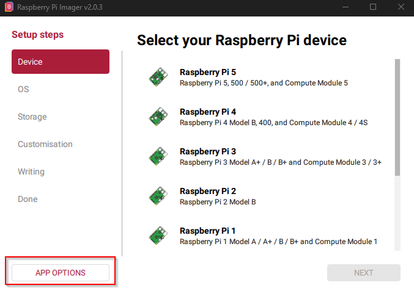
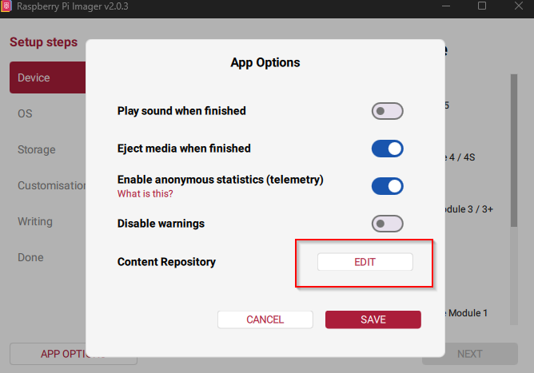
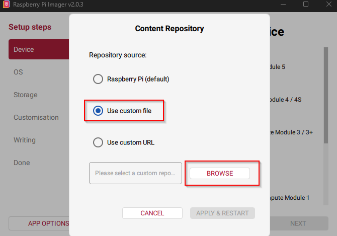

# Flash and first boot

This is the moment the soldering turns into an instrument. Do it with the
[open assembly](assembly-manual.md#4-open-assembly) wired up and the case still
off, so anything that misbehaves is still within reach.

The Raspberry Pi Zero 2 W and the Orange Pi Zero 2W use different images, but
from here on the steps are the same.

## 1. Download the board image

Open the [releases page](https://github.com/nexxyz/octessera/releases) and
download the image for **your** board:

| Board | Image file |
|---|---|
| Raspberry Pi Zero 2 W | `octessera-<version>-raspberry-pi-zero-2w.img.zip` |
| Orange Pi Zero 2W | `octessera-<version>-orange-pi-zero-2w.img.xz` |

If you want to check the download, compare it against its line in
`SHA256SUMS.txt`, which covers both images. The two boards' images are not interchangeable: an Orange card
in a Raspberry (or the other way round) won't boot.

## 2. Flash the microSD card

1. Put the boot microSD card into your computer or card reader.
2. Open [BalenaEtcher](https://etcher.balena.io/). It reads the `.img.zip` and
   `.img.xz` files directly; no need to unpack them first.
3. Select the downloaded image, select the microSD card, and start flashing.
   Double-check the target drive. Flashers erase whatever you point them at.
4. When it finishes, eject the card safely.

BalenaEtcher is the normal path for both boards, and the one to use for the
Orange Pi.

### Optional: Raspberry Pi Imager (Raspberry only)

The Raspberry release also includes
`octessera-<version>-raspberry-pi-zero-2w.rpi-imager-manifest`, which lets
Raspberry Pi Imager show Octessera as an OS choice:

1. Open Imager and choose **App Options**.

   

2. Next to **Content Repository**, choose **Edit**.

   

3. Choose **Use custom file** (and browse to the downloaded manifest) or **Use
   custom URL**, then **Apply & Restart**.

   

> **Important:** The easiest route is to flash the image as-is and set up
> Wi-Fi, the password and SSH with Octessera's own [setup
> portal](#4-configure-wi-fi-and-access). If you do use Imager's customisation
> instead, keep the username exactly `pi`. **Do not change it.** The Raspberry
> runtime depends on that account.

Imager can configure SSH, the hostname and Wi-Fi. A plain flash without Imager
customisation leaves SSH switched off until you turn it on in the setup portal.

## 3. Power the open assembly

1. Put the flashed card into the compute board.
2. Keep the enclosure open for this first boot.
3. Connect audio if you want to hear the first result.
4. Power the instrument through the USB-C power breakout. Not through the
   Raspberry Pi's own micro-USB power connector; see [safety and
   power](safety-and-power.md).
5. Wait for the Octessera boot animation and then the normal menu. The first
   boot can take a little longer than later ones.

Nothing on the OLED, or flickering? Unplug and check [troubleshooting](../troubleshooting.md)
before trying again.

## 4. Configure Wi-Fi and access

Wi-Fi is optional for making music, but it is how you get updates, backups and
SSH. A fresh image does not start a hotspot or SSH on its own; you ask for it.

On the instrument, open:

`System > Connections > Wi-Fi > Setup Portal`

and confirm **Open Portal**. The OLED then shows the hotspot name, the address
to open, and a 10-minute countdown for the portal.

> **Heads-up:** Until setup finishes, anyone nearby who joins the setup hotspot
> can configure the instrument. Open it while you are there, finish promptly,
> and do not leave it running in a public place.

On a phone or computer:

1. Join the Wi-Fi network `Octessera Setup <suffix>` shown on the OLED.
2. Browse to `http://192.168.42.1`.
3. Enter your two-letter country code, then pick a scanned network or type its
   name, and enter its password (or tick the open-network box).
4. Set the local device password, at least 8 characters. The page tells you
   which account it is for: `pi` on the Raspberry Pi, `octessera` on the Orange
   Pi. You need it even if you switch SSH off.
5. Choose how you want SSH:
   - **SSH key (recommended):** paste your public key; password login stays
     off.
   - **SSH password:** SSH accepts the local device password from step 4.
   - **No SSH setup:** remote access stays off.
6. Optionally enter a device name (hostname). Leave it blank to keep the current
   one: `octessera-rpi` on the Raspberry Pi or `octessera-opi` on the Orange Pi
   on a fresh card.
7. Press **Apply setup**.

The browser will probably lose its connection while the settings apply, because
the hotspot goes away. That is expected. Leave the instrument powered and trust
the OLED, not the browser. On success, the board's address appears under
`System > Maintenance > Sys. Info`; no reboot is needed. If the OLED reports a
failure or a timeout, close the message and open the portal again.

To change the network, password, SSH or name later, see [setup
portal](setup-portal.md).

## 5. Finish the open-air checks

With setup done (or skipped), close the portal message if it is still showing,
and check the encoders, OLED and NeoTrellis connection while everything is still
in reach. The full checklist, and why the NeoKey switches wait for the
enclosure top, are in the [assembly manual](assembly-manual.md#5-flash-and-setup).

Then carry on with the [enclosure steps](assembly-manual.md#6-enclosure) and the
[final check](assembly-manual.md#7-final-check).

For USB connections to a computer or USB devices, see [USB roles](usb-roles.md).
