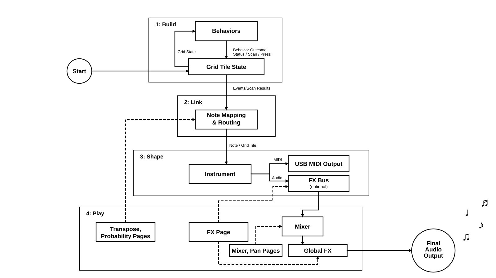

# Sound and Link: from tiles to sound

A behavior only moves tiles around. Three more stops turn that motion into
music:

1. **Link** decides which tile changes count as notes, which instrument they
   go to, what pitch they get, and what else the grid position steers.
2. **Shape** decides what those notes sound like: the instrument, its
   settings, and where its audio goes.
3. **FX buses and Global FX** color the sound on its way out.

Every row in these menus has its own context help on the instrument (hold
*Shift* + *Fn* and click *Main*). This page is the map; the help is the street
view.

## Link: what counts as a note

Each layer has its own Link page (`Link > L1` to `L8`). A layer can make notes
in two ways, and you can use both at once.

### Events: tiles changing state

Under **Events**, three moments in a tile's life can each trigger something:

| Event | When it fires | Usual job |
|---|---|---|
| **On** | A tile turns on | `note on` |
| **Hold** | A tile stays on through a step | Often `none`; `note on` for droning, insistent layers |
| **Off** | A tile turns off | `note off`, so held notes stop |

Each event has an **Inst** (instrument slot 1 to 8), a **Trig** (`none`,
`note on` or `note off`), a **Delay** (0 to 16 layer ticks) and a **Retrig**
(0 to 8 extra repeats, one tick apart). Delay and Retrig are a cheap way to
turn one blip into a little echo figure without touching an effect.

**Event Triggers** switches On and Off off for the layer without losing their
settings. **State Notes** does the same for Hold, which fires at every step for
each tile that stays lit. The play behaviors (`keys`, `looper`, `sequencer`) and
the games make their own events, so Hold stays quiet on them.

On an instrument in `hold` mode, a pitch sounds once however many tiles play
it, and it ends only when the last of them turns off. Turn **Root** or
**1st Note** while a note hangs and it still ends cleanly when its tile goes
dark.

### Scanning: a playhead over the grid

Under **Scanning**, set **Scan Mode** to `scanning` and the layer gets a
cursor that sweeps rows or columns (**Scan Axis**, **Scan Dir**) at the
**Scan Unit** rate, from `1/32T` up to `1/1`. When the cursor finds a lit tile
it plays **Instrument** with **Action**; crossing a dark tile can fire the
separate **Empty Inst** / **Empty Act** pair, handy for release notes or a
ghostly counter-rhythm. **Sections** (1, 2, 4 or 8) splits the sweep into
shorter lanes, so one grid becomes several short loops.

On a `hold` instrument the cursor plays tiles like a piano roll: lit steps in a
row on one pitch make one long note, and the first dark step ends it. A
`oneshot` instrument hits again on every lit step.

Scanning suits slow, sculptural worlds like `dla`, `coral` and `vines`: their
shape becomes a sequence instead of a trickle of birth events.

### Note Mapping: which pitches

**Note Mapping** keeps a layer in key:

- **Set** picks the note collection: Scales (Chromatic, Major, Natural Minor,
  Harmonic Minor, Dorian, Mixolydian), Chord Tones (triads, sus, sevenths,
  ninths), Pentatonic (including Hirajoshi-, In Sen- and Iwato-like sets) and
  Symmetric (Whole Tone, two Octatonics).
- **Root** sets the key.
- **1st Note** is where pitch counting begins.
- **Low Note** and **High Note** fence the range, and **Out of Range** decides
  what happens at the fence: `clamp` stops at the edge, `wrap` folds back
  round.

Chord Tones sets are lovely on busy layers. Everything that sounds belongs to
one chord, so even chaos sounds like it meant it.

### X and Y: position steers the sound

**X Axis** and **Y Axis** turn where a tile sits into how it sounds. Each lane
has its own **Enabled** switch.

- **Pitch Steps** moves the pitch by **Steps** (-16 to 16) notes of the set per
  tile along that axis, so `1` walks up the scale and `-1` walks down it. **Restart Section** turns scan sections into little grids of their own:
  each lane counts from its own edge, so they all play in the same register.
  It works on the axis the lanes split (Y for column sections, X for row
  sections).
- **Velocity**, **Filter Cutoff** and **Filter Res** map position onto a
  **From** to **To** range, with a **Curve** and a small **Grid Offs** nudge.
- **Slot 1** and **Slot 2** can drive any mappable parameter (an FX mix, a
  synth's detune, a bus volume), each with its own **Invert** row.

A `boids` flock drifting right can open a filter while a `wave` on another
layer makes the delay bloom.

### Trigger probability: not every time

**Trigger Prob. > Mode** decides which triggers get through:

- `full` lets them all through and `zero` blocks the layer.
- `custom` uses a per-tile map you paint with **Map Prob Grid**. Each press
  cycles a tile through zero, low, high and full (the colors are in the
  [cheat sheet](controls-cheat-sheet.md#assignment-modes)); *Shift* paints a
  row and *Shift* + *Fn* a column.
- **Prob Low** and **Prob High** set what "low" and "high" mean, in percent.
- **Prob Note Off** decides whether note-offs roll the dice too. It starts
  off, so a held note always gets its release, even at `zero`. Turn it on
  if you like notes that sometimes forget to stop.

Play's **Trigger Gate** page sets the same mode from the grid, and the patch
saves whatever it was left on.

### Arp: notes in a line instead of a lump

When several notes arrive together, **Arp > Mode** can spread them out: `up`,
`down`, `bounce`, `outside in`, `rotating`, `random`, `octave spread` or
`strum`. `direct` and `chord strike` keep them together; `none` leaves Link
alone.

- **Source** picks notes arriving in one batch (`simultaneous`) or notes the
  layer is holding (`held`). On a `oneshot` instrument a tile counts as held
  while it's lit, so `held` arpeggiates whatever is glowing.
- **Step**, **Length**, **Gate** and **Octaves** shape the run.

### Tempo and swing

Tempo, swing and the LFOs live at the top of **Link**, not under a layer.

- **BPM** (`Link > BPM`) sets the tempo, 40 to 240. The shipped patch runs
  at 120.
- For a quicker grab, hold *Fn* and press the fourth tile up in the right-hand
  column: the **Tempo** Play page. Its top five rows are tempo tiles from 50
  to 240 BPM, the top-left one is Tap, and the row below nudges by -4 to +4.
- To follow another device's clock instead, set
  `System > MIDI > Sync / Clock > Sync` to `external` and switch **Clock In**
  on.
- **Swing A** and **Swing B** set the swing ratio: how long each beat's first
  eighth lasts against its second. `4` and `4` is straight, `5:3` is a lazy
  shuffle, `3:5` rushes the offbeat. Steps land exactly on the ratio, even
  between clock pulses. Following an external MIDI clock, a swung step waits
  for the first clock pulse at or after its spot instead, since nobody tells
  us when the next pulse will come. External MIDI clock out stays straight.
  A new ratio kicks in at the next beat, so twisting it mid-beat won't flam.
  The Tempo Play page has both rows on the grid.
- BPM and both Swing rows are targets too, under **Link** in the usual list. Put
  the tempo on a CC knob or the XY pad and it goes where you leave it, saved
  like any other setting. Put it on an LFO and the music breathes faster and
  slower around the BPM you set, which stays put. Under an external clock the
  other device keeps the pace, so a tempo knob only changes the BPM row and a
  tempo LFO sits still.
- **LFOs** has eight global sine LFOs. Switch one **Enabled**, pick a
  **Target** (the list only offers parameters that are safe to wobble while
  playing), a **Period** in note lengths (up to eight bars) and a **Depth**. An LFO adds its
  wobble on top of anything else steering the same parameter. A switched-off LFO keeps counting
  along with the music, so when you switch it back on it comes in right where it would have been.
- Each layer's **Seeded** row makes trigger probability and random arp orders
  repeatable; see [Seeds](behaviors-and-play.md#seeds-surprises-you-can-keep).

### MIDI CC In: your knobs, steering the worlds

**Link > MIDI CC In** has eight slots, **CC1** to **CC8**, that let the knobs
and faders on a MIDI controller move parameters, much like the XY pad does.

A MIDI keyboard's knobs and faders work here, and its keys play the
instruments; see [MIDI keyboards](#midi-keyboards-play-the-slots) below.

- Switch on `System > MIDI > MIDI Active` and connect the controller under
  **MIDI In** (or plug a computer into USB MIDI). Clock and sync settings
  don't matter here.
- In a slot, press **Learn** and wiggle the knob you want. The slot takes its
  CC number and channel (`CC1: learned CC 74 ch 1`). Back, or ten seconds of
  silence, cancels. You can also set **CC** and **Channel** by hand; `any`
  listens on every channel.
- Pick a **Target** from the usual list and narrow it with **Range Min** and
  **Range Max**. The knob's full turn sweeps that range, and **Invert** turns it
  around.
- The parameter stays where the knob left it. The mappings are saved with the
  patch, but a freshly loaded patch keeps its saved values until you touch a
  knob, so nothing jumps on load. If your controller has a "reset all
  controllers" button (it sends CC 121), pressing it lets go of the knobs on its
  channel and the parameters slide back to the patch values.
- Switch-like parameters (on/off, a choice from a list) take one driver at a
  time. If an XY slot or another CC already has one, you get `Already on another control. Clear that first.`

### MIDI keyboards: play the slots

Plug in a MIDI keyboard the same way (`System > MIDI > MIDI Active` on, the
keyboard picked under **MIDI In**, or a computer on USB MIDI) and its keys play
the instrument slots directly. The keyboard's MIDI channel picks the slot:
channel 1 plays I1, channel 2 plays I2, up to channel 8 for I8. Channels 9 to
16 are left alone, so a keyboard set to channel 10 for drums elsewhere won't
wander in by accident.

- Notes sound the moment you hit the key, as quick as a Keys tile, and they're
  never nudged onto a step. How hard you play comes through, and the slot's
  velocity sensitivity does the rest.
- A note plays for as long as you hold the key, whatever the slot's Note Mode.
  Let go and it ends, or it fades out on its own first if the sound decays.
- A Drum slot plays the voice whose Sound has that General MIDI note (kick 36,
  snare 38, closed hat 42 and so on), and a Sampler plays its slots 1 to 8 on
  notes 36 to 43 (other keys stay quiet on a Sampler). Same numbers as Send
  MIDI, so a part recorded in a DAW comes back the way it went out.
- A `MIDI Inst.` or `MIDI Drum` slot passes the note on to its own channel on
  MIDI out, as long as it's enabled. Handy for playing outboard gear through
  Octessera without re-patching cables. Gear that echoes its input straight
  back is fine too. When Octessera plays a note on MIDI out itself (MIDI
  parts, Keys presses, Send MIDI copies), a note coming back on that channel
  and key within a second counts as our own echo and is ignored, so it can't
  bounce around forever. The catch: if you play that very
  key on that channel within the same second, you won't hear it. A key you
  play through to MIDI out ignores an identical copy only while you're still
  holding it, so drumming one pad fast always plays every hit. A quick tap
  through gear that's slow to send it back can still bounce around; if you
  hear that, hold keys a little longer or turn that thru off. Letting go of a
  key always counts, echo or not.
- Stop, Pause, Panic and loading a patch let go of every key you're still
  holding, notes passed on to MIDI out included, so nothing gets stuck.
- **Recording into a Looper.** Every `looper` layer that is overdubbing and
  whose Link plays that slot records what you play as tile presses, on the tile
  its Link would play that note from (after Play Transpose). Drum, Sampler and
  MIDI Drum slots use a tile stamped with the voice, sample or note you hit
  instead. If two tiles fit, the one lowest on the grid wins (leftmost if they
  share a row). A note no tile can play still sounds, it just isn't recorded.
  It lands on the same step a grid press would, the nearest one: see
  [Looper recording](behaviors-and-play.md#looper-recording) for how.
- **The Looper keeps the tile, not the note.** On replay the tile goes through
  the layer's Link as it is then, like a grid press would. So:
  - how hard you hit the key isn't kept; the mapping sets the velocity;
  - with a chord note set or Arp on the layer, one recorded key comes back as
    the whole chord or arpeggio;
  - change the scale or the mapping later and the recording follows it to the
    new notes. Handy, or a happy accident, depending on the day.
- Not in the mood? `System > MIDI > Notes In` off ignores the keys and keeps
  the knobs. It's a device setting, so it stays put when you load a patch.

## Shape: what it sounds like

`Shape > Instruments` holds eight instrument slots. Link's **Inst** numbers
point at them.

| Type | What it is | Where to start |
|---|---|---|
| `synth` | Two oscillators into a filter, with amp and filter envelopes | **Osc 1** > Wave and Octave, then **Filter** > Cutoff and **Filter Env** |
| `FM` | A sine carrier and modulator: bells, keys, glassy tones | **Tone** > Ratio and Index, then **Index Env** > Decay |
| `Plucked` | A modelled ringing string | **String** > Decay, Brightness and Pick Pos |
| `Drum` | An eight-voice kit; tiles are stamped with voices | **Kit** > Load, set the **Tile** rows, then **Assign** |
| `sampler` | Eight WAV slots; tiles are stamped with samples | **Browse** for a sample, set the **Tile** rows, then **Assign** |
| `MIDI Inst.` | Sends notes to external gear instead of making sound | **MIDI** > Enabled, then Channel and Velocity |
| `MIDI Drum` | Turns stamped tiles into MIDI drum notes for external gear | **MIDI Drum** > Enabled, set **Note** and **Tile Vel**, then **Assign** |

- **Presets and kits.** Synth, FM and Plucked have **Preset > Load**; Drum and
  Sampler have **Kit > Load**. Loading asks first and only changes that slot.
  The list below says what each one is for, and so does *Shift* + *Fn* +
  **Main** on its row.
- **Note Mode.** `oneshot` gives each trigger a finite note, as long as the
  playing layer's **Link > One-Shot Len** says (150 ms to start with). That's
  an arrangement choice, so it lives with the layer: one synth can play
  staccato blips on one layer and long tones on another. MIDI Inst. slots
  follow it too. An Off event set to `note off` can still end a one-shot
  early. `hold` keeps the note
  sounding until its tile's Off event, or on a scan until the first dark step.
  Drum hits are always one-shot.
- **Envelopes.** Attack, Decay, Sustain and Release do what they say, and
  Decay runs after the attack whatever the attack length. A sampler's Amp Env
  starts out flat (no attack, full sustain, a 5 ms release) and its filter
  starts fully open, so a sample plays exactly as recorded until you shape it. Give it a slow attack for swells, or a
  short decay and low sustain to chop a loop into stabs. Its Filter Env only
  moves the filter once **Env Amount** is off zero.
- **Start and loops.** Each sample slot has its own **Start**, **Loop**,
  **Loop Start** and **Loop End**, all in percent of the sample, right under
  the slot's Browse row. **Start** skips the front of a sample (a sleepy
  attack, a breath of silence) in either Note Mode. **Loop** only wakes up in
  `hold`: `forward` keeps running round from Loop Start to Loop End, and
  `ping-pong` bounces back and forth between them, for as long as the note is
  held. Let go and the Amp Env release fades it out. Every forward pass lasts
  exactly the loop, handy for bar loops, and the seam crossfades with up to
  10 ms of the sample just before Loop Start, so even a careless loop point
  won't click, though a loop that sits on a steady part of the sound will be
  the smoothest. At Loop Start 0% there's nothing before it to borrow, so the
  seam takes a 1 ms breath instead: out and back in. In
  `oneshot` the sample just plays once, loop or no loop.
- **MIDI.** A `MIDI Inst.` or `MIDI Drum` slot sends nothing until its
  **Enabled** is on (and `System > MIDI > MIDI Active` is on). MIDI never
  passes through the internal effects.
- **Internal notes on MIDI out.** Out of the box only the MIDI slots talk to
  MIDI out. Set `System > MIDI > Send MIDI` to `all inst.` and the synth,
  FM, Plucked, Drum and Sampler slots send their notes too, each on its slot's
  channel (slot 1 on channel 1, and so on), while still playing here. A Drum
  hit sends the General MIDI note of its voice's Sound (kick 36, snare 38,
  closed hat 42 and so on), and Sampler slots 1 to 8 send notes 36 to 43, each
  as a short 100 ms note. Handy for doubling a part on outboard
  gear. Flip it back to `MIDI inst.` and any note still held gets its
  note-off, so nothing hangs on the other end. Muting a slot in Play Mix
  silences its MIDI copy too, the same tidy way.

### Factory sounds

Every list starts with the plain default (Init, or Default for Drum), and the rest are
starting points I liked enough to keep. Load one, then turn knobs until it's yours. Drum kits
never change a voice's Sound, so V1 stays the kick and your stamps keep their jobs.

**Synth**

| Preset | What it is |
|---|---|
| Init | The honest blank page: a saw and a square through a gentle lowpass. |
| Round Bass | Warm, rubbery low end that sits under anything. |
| Acid Bass | One saw, one squelchy resonant filter, no apologies. |
| Saw Lead | Two detuned saws that actually sing a line. |
| Soft Pad | A soft cushion that blooms after short notes. |
| Bright Pluck | Sparkly, short and generous with the delay. |
| Brass Stab | Fat detuned saws with a brassy filter blip. |
| Organ | Two drawbars and a draught: clicky stabs, or held chords. |
| Hollow PWM | Nasal, hollow and a little woody. |
| Chip Blip | Square-wave game sounds. Also the cheapest synth here. |
| Zap | Resonant laser bloops for accents and nonsense. |

**FM**

| Preset | What it is |
|---|---|
| Init | A neutral 2:1 FM starting point. |
| Soft Keys | A mellow electric piano, rounded off. |
| Tine EP | The electric piano that barks when you play it hard. |
| Thump Bass | Punchy, woody FM bass with a growl up top. |
| Swell Bass | A bass whose harmonics creep in after each note starts. |
| Reed Lead | A woody, clarinet-ish line. |
| Warm Pad | A slow-beating FM haze. |
| Mallet | A marimba-ish knock with a quick bloom. |
| Bell | Big, bright and churchy. |
| Glass | Small, high and fragile. |
| Clang | Detuned metal: gongs, pipes, the odd bin lid. |

**Plucked**

| Preset | What it is |
|---|---|
| Init | A plain ringing string. |
| Nylon | A warm classical guitar. |
| Steel | A bright, long-ringing steel string. |
| Muted | A palm-muted chug. |
| Harp | Clean, long and gentle, with lots of room for arps. |
| Koto | A twangy near-bridge pluck made for pentatonics. |
| Kalimba | Tines and a wooden box. |
| Pizz | A string section plucking politely. |
| Pluck Bass | An upright-ish thump. |
| Sitar Buzz | Wiry, buzzy, sympathetic jangle. |
| Droplet | A water plink, not really a string at all. |

**Drum kits**

| Preset | What it is |
|---|---|
| Default | A balanced all-rounder. |
| Tight | Dry and short. |
| Heavy | Big, boomy and tuned down. |
| Boom | A long sub kick and a snappy top, with 808 energy. |
| Lo-Fi | Dusty and dark, slightly flat. |
| Electro | A zappy kick and laser toms. |
| Brush | Jazz brushes, a ride on V4 and a cross-stick on V8. |
| Hand Perc | Congas, bongos, a shaker and a clave. |
| Minimal | Ticks, blips and a polite thud. |
| Toy Box | Everything pitched up and a bit too cheerful. |

### Drum and Sampler tiles are stamps

Drum and Sampler tiles play what's stamped onto them, not Link's pitch.

1. Pick the voice (Drum **Voice**) or sample (**Sample Slot**).
2. Set **Tile Tune** (-24 to 24 semitones), **Tile Fine** (-100 to 100 cents)
   and **Tile Level** (Base, High, Medium or Low).
3. Click **Assign** and press tiles. Each press copies those values onto the
   tile, like a rubber stamp. *Shift* stamps the whole row, *Shift* + *Fn* the
   whole column. **Back** finishes.

Want a chromatic row? Stamp each tile with the next Tile Tune. Want a ghost
note? Stamp it Low. On a Sampler, **Tile Level** only appears once
**Vel Levels** is on. High, Medium and Low tiles play at the Vel Levels
velocities; Base tiles play at the normal velocity. To change a tile, stamp it
again. Pressing a tile that already matches exactly clears it.

Everything else (Tune, Gain, Filter, the Vel Levels values) stays slot-wide,
and anything you modulate there still reaches every stamped tile. Loading a
kit swaps the sounds but keeps your stamps.

- **Follow Transp.** lets Play's Transpose page shift these tiles too. Off by
  default.
- **Follow Pitch** makes the tiles play Link's note instead of a fixed pitch,
  measured from C4. Tile Tune and Tile Fine then answer "how far do I nudge
  this sample so it sounds like a C4?". Stamp a bass hit with `-5` and it
  lands on the G below when Link plays C4, then follows Link's melody from
  there. Drums can do it too, for tuned toms that wander with the tune.

### MIDI Drum tiles are stamps too

A `MIDI Drum` slot works like a Drum kit whose sounds live in another box.
Set **Note** (it shows the note name and General MIDI drum name, so
`38 D2 Snare` is easy to spot) and **Tile Vel**, click **Assign** and press
tiles, with the same *Shift* row and *Shift* + *Fn* column tricks. **Back** finishes.

When Link strikes a stamped tile, the slot sends that note and velocity on
its **Channel** (10, the usual drum channel, unless you change it) and lets
go after **Duration**. Tiles you didn't stamp stay quiet, which makes it easy
to leave holes in a pattern. Mute, the trigger gate and trigger probability
work on it like on any other slot. It never makes a sound of its own, so if
nothing happens, check that the drum machine on the other end is listening
on the same channel.

### Mixer

Each internal instrument's **Mixer** has **Route** (`direct` to the main mix,
or `fxb1` to `fxb4`), **Volume** and **Pan Pos**. A slot routed to a
bus takes its pan from the bus. Play Mix and Play Pan edit the same values.

## FX buses: shared effect chains

`Shape > FX Buses` has four buses. Each runs **Slot 1 → Slot 2 → Slot 3** in
order, then its own **Volume** and **Pan Pos**, into the main mix. Send
instruments there with their **Route**.

| Type | Does | Type | Does |
|---|---|---|---|
| `delay` | Echoes, in ms or synced to a note length | `reverb` | Space and tails |
| `chorus` | Doubling shimmer | `flanger` | Swooshing comb filter |
| `vibrato` | Pitch wobble | `tremolo` | Volume pulsing |
| `auto_pan` | Moves the bus around the stereo field | `filter_lfo` | Self-moving filter |
| `wah` | Vocal filter sweep | `glitch` | Stutters |
| `vinyl` | Lo-fi warmth, crackle and warp | `bitcrusher` | Grit |
| `eq` | Three-band tone shaping (±12 dB) | `compressor` | Evens out levels |
| `saturator` | Soft clipping and warmth | `distortion` | Hard clipping |
| `duck` | Turns this bus down when another instrument or bus is loud | `none` | Passes sound through |

**Duck** is the pumping trick. Put a pad on Bus 1 with `duck` sourced from
your kick instrument, and the pad breathes in time.

Choosing a Type loads sensible starting values, so it's safe to try things.
All twelve slots can be busy at once, but see the
[performance table](performance-and-live.md#practical-performance) before you ask a
Raspberry to run them all.

## Global FX: the finishing touch

`Shape > Global FX` has two slots on the whole mix, after everything is
summed: `vinyl`, `eq`, `compressor`, `saturator`, `distortion` or
`bitcrusher`. A touch of `saturator` or `compressor` glues the layers together.
`distortion` and `bitcrusher` here affect everything, so go gently.

## Turning knobs

Time, frequency and decay rows take finer steps where small changes matter,
so a short attack or a long reverb tail is easy to set. The details are in the
[controls cheat sheet](controls-cheat-sheet.md#regular-controls).

## A patch to try

1. **Layer 1:** `sequencer` → Inst 1 set to `Drum`. Stamp a kick, snare and
   hat onto a few tiles.
2. **Layer 2:** `boids` → Inst 2 set to `synth`, Route `fxb1`. Note
   Mapping Set `Minor Pentatonic`; X Axis **Filter Cutoff** enabled.
3. **Bus 1:** Slot 1 `delay` synced to a note, Slot 2 `duck` sourced from
   `I1`.
4. **Link > LFOs > LFO1:** Enabled, target Bus 1's delay mix, Period `1/1`,
   Depth around 30%.
5. Press **Play**, then open the **XY** Play page and steer it by hand.

The drums anchor the beat, the flock wanders and opens the filter, the delay
ducks out of the kick's way, and the LFO keeps the echoes from sitting still.
