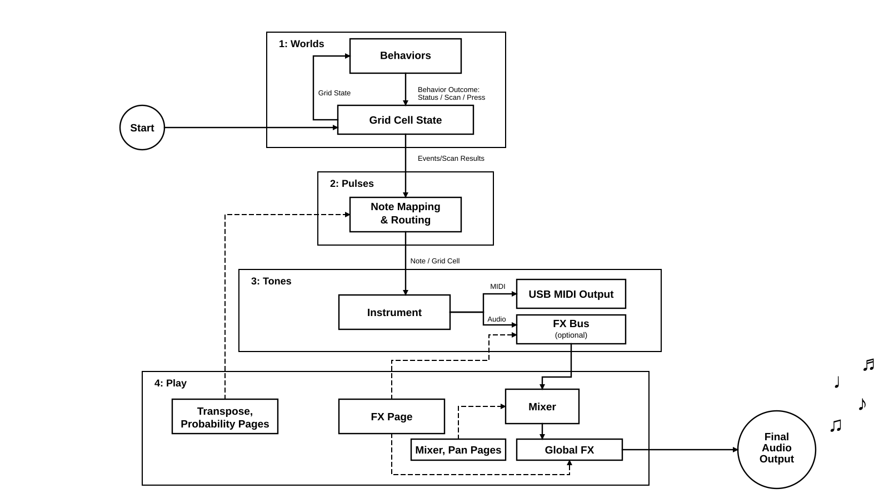

# Sound and Link: from cells to sound

A behavior only moves cells around. Three more stops turn that motion into
music:

1. **Link** decides which cell changes count as notes, which instrument they
   go to, what pitch they get, and what else the grid position steers.
2. **Shape** decides what those notes sound like: the instrument, its
   settings, and where its audio goes.
3. **FX buses and Global FX** colour the sound on its way out.

Every row in these menus has its own context help on the instrument (hold
*Shift* + *Fn* and click *Main*). This page is the map; the help is the street
view.

## Link: what counts as a note

Each layer has its own Link page (`Link > L1` to `L8`). A layer can make notes
in two ways, and you can use both at once.

### Events: cells changing state

Under **Events**, three moments in a cell's life can each trigger something:

| Event | When it fires | Usual job |
|---|---|---|
| **On** | A cell turns on | `note_on` |
| **Hold** | A cell stays on | Often `none`; `note_on` for droning, insistent layers |
| **Off** | A cell turns off | `note_off`, so held notes stop |

Each event has an **Inst** (instrument slot 1 to 8), a **Trig** (`none`,
`note_on` or `note_off`), a **Delay** (0 to 16 layer ticks) and a **Retrig**
(0 to 8 extra repeats, one tick apart). Delay and Retrig are a cheap way to
turn one blip into a little echo figure without touching an effect.

**Event Triggers** switches the whole event path off for the layer without
losing its settings. **State Notes** lets the layer also play from its current
state on every transport tick.

### Scanning: a playhead over the grid

Under **Scanning**, set **Scan Mode** to `scanning` and the layer gets a
cursor that sweeps rows or columns (**Scan Axis**, **Scan Direction**) at the
**Scan Unit** rate, from `1/32T` up to `1/1`. When the cursor finds a lit cell
it plays **Instrument** with **Action**; crossing a dark cell can fire the
separate **Empty Inst** / **Empty Trig** pair, handy for release notes or a
ghostly counter-rhythm. **Sections** (1, 2, 4 or 8) splits the sweep into
shorter lanes, so one grid becomes several short loops.

Scanning suits slow, sculptural worlds like `dla`, `coral` and `vines`: their
shape becomes a sequence instead of a trickle of birth events.

### Note Mapping: which pitches

**Note Mapping** keeps a layer in key:

- **Set** picks the note collection: Scales (Chromatic, Major, Natural Minor,
  Harmonic Minor, Dorian, Mixolydian), Chord Tones (triads, sus, sevenths,
  ninths), Pentatonic (including Hirajoshi-, In Sen- and Iwato-like sets) and
  Symmetric (Whole Tone, two Octatonics).
- **Root** sets the key.
- **Start Note** is where pitch counting begins.
- **Low Note** and **High Note** fence the range, and **Out of Range** decides
  what happens at the fence: `clamp` stops at the edge, `wrap` folds back
  round.

Chord Tones sets are lovely on busy layers. Everything that sounds belongs to
one chord, so even chaos sounds like it meant it.

### X and Y: position steers the sound

**X Axis** and **Y Axis** turn where a cell sits into how it sounds. Each lane
has its own **Enabled** switch.

- **Pitch Steps** moves the pitch by **Steps** (-16 to 16) per cell along that
  axis. **Restart Section** turns scan sections into little grids of their own:
  each lane counts from its own edge, so they all play in the same register.
  It works on the axis the lanes split (Y for column sections, X for row
  sections).
- **Velocity**, **Filter Cutoff** and **Filter Res** map position onto a
  **From** to **To** range, with a **Curve** and a small **Grid Offs** nudge.
- **Slot 1** and **Slot 2** can drive any mappable parameter (an FX mix, a
  synth's detune, a bus volume), each with its own **Invert** row.

A `boids` flock drifting right can open a filter while a `wave` on another
layer makes the delay bloom.

### Trigger probability: not every time

**Trigger Prob. > Mode** decides which triggers get through:

- `full` lets them all through and `zero` blocks the layer.
- `custom` uses a per-cell map you paint with **Map Prob Grid**. Each press
  cycles a cell through zero (dark), low (magenta), high (yellow) and full
  (green); *Shift* paints a row and *Shift* + *Fn* a column.
- **Prob Low** and **Prob High** set what "low" and "high" mean, in percent.

Play's **Trigger Gate** page overrides the mode live without changing what's
saved.

### Arp: notes in a line instead of a lump

When several notes arrive together, **Arp > Mode** can spread them out: `up`,
`down`, `bounce`, `outside_in`, `rotating`, `random`, `octave_spread` or
`strum`. `direct` and `chord_strike` keep them together; `none` leaves Link
alone.

- **Source** picks notes arriving in one batch (`simultaneous`) or notes the
  layer is holding (`held`).
- **Step**, **Length ms**, **Gate %** and **Octaves** shape the run.

### LFOs, tempo and swing

These live at the top of **Link**, not under a layer.

- **LFOs** has eight global sine LFOs. Switch one **Enabled**, pick a
  **Target** (the list only offers parameters that are safe to wobble while
  playing), a **Period** in note lengths and a **Depth %**. An LFO adds its
  wobble on top of anything else steering the same parameter.
- **BPM** sets the tempo (40 to 240).
- **Swing** delays the off-beats of internal steps and scanning, for groove
  without bending the main clock. External MIDI clock out stays straight.
- Each layer's **Seeded** row makes trigger probability and random arp orders
  repeatable; see [Seeds](behaviors-and-play.md#seeds-surprises-you-can-keep).

## Shape: what it sounds like

`Shape > Instruments` holds eight instrument slots. Link's **Inst** numbers
point at them.

| Type | What it is | Where to start |
|---|---|---|
| `synth` | Two oscillators into a filter, with amp and filter envelopes | **Osc 1** > Wave and Octave, then **Filter** > Cutoff and **Filter Env** |
| `FM` | A sine carrier and modulator: bells, keys, glassy tones | **Tone** > Ratio and Index, then **Index Env** > Decay |
| `Plucked` | A modelled ringing string | **String** > Decay, Brightness and Pick Pos |
| `Drum` | An eight-voice kit; cells are stamped with voices | **Kit** > Load, set the **Cell** rows, then **Assign** |
| `sampler` | Eight WAV slots; cells are stamped with samples | **Browse** for a sample, set the **Cell** rows, then **Assign** |
| `midi` | Sends notes to external gear instead of making sound | **MIDI** > Enabled, then Channel, Velocity and Duration |

- **Presets and kits.** Synth, FM and Plucked have **Preset > Load**; Drum and
  Sampler have **Kit > Load**. Loading asks first and only changes that slot.
- **Note Mode.** `oneshot` gives each trigger a finite note. `hold` keeps the
  note sounding until a matching `note_off`, which is what Off events and the
  scan's empty action are for. Drum hits are always one-shot.
- **Envelopes.** Attack, Decay, Sustain and Release do what they say, and
  Decay runs after the attack whatever the attack length. A sampler's Amp Env
  starts out flat (no attack, full sustain, a 5 ms release) and its filter
  starts fully open, so a sample plays exactly as recorded until you shape it. Give it a slow attack for swells, or a
  short decay and low sustain to chop a loop into stabs. Its Filter Env only
  moves the filter once **Env Amount** is off zero.
- **MIDI.** A `midi` slot sends nothing until its **MIDI > Enabled** is on
  (and `System > MIDI > MIDI Active` is on). MIDI never passes through the
  internal effects.

### Drum and Sampler cells are stamps

Drum and Sampler cells play what's stamped onto them, not Link's pitch.

1. Pick the voice (Drum **Voice**) or sample (**Sample Slot**).
2. Set **Cell Tune** (-24 to 24 semitones), **Cell Fine** (-100 to 100 cents)
   and **Cell Level** (Base, High, Medium or Low).
3. Click **Assign** and press cells. Each press copies those values onto the
   cell, like a rubber stamp. *Shift* stamps the whole row, *Shift* + *Fn* the
   whole column. **Back** finishes.

Want a chromatic row? Stamp each cell with the next Cell Tune. Want a ghost
note? Stamp it Low. On a Sampler, **Cell Level** only appears once
**Vel Levels** is on. High, Medium and Low cells play at the Vel Levels
velocities; Base cells play at the normal velocity. To change a cell, stamp it
again. Pressing a cell that already matches exactly clears it.

Everything else (Tune, Gain, Filter, the Vel Levels values) stays slot-wide,
and anything you modulate there still reaches every stamped cell. Loading a
kit swaps the sounds but keeps your stamps.

- **Follow Transp.** lets Play's Transpose page shift these cells too. Off by
  default.
- **Follow Pitch** makes the cells play Link's note instead of a fixed pitch,
  measured from C4. Cell Tune and Cell Fine then answer "how far do I nudge
  this sample so it sounds like a C4?". Stamp a bass hit with `-5` and it
  lands on the G below when Link plays C4, then follows Link's melody from
  there. Drums can do it too, for tuned toms that wander with the tune. (Taps
  on the Play Drums page have no Link note, so they play the stamped pitch.)

### Mixer

Each internal instrument's **Mixer** has **Route** (`direct` to the main mix,
or `fx_bus_1` to `fx_bus_4`), **Volume** and **Pan Pos**. A slot routed to a
bus takes its pan from the bus. Play Mix and Play Pan edit the same values.

## FX buses: shared effect chains

`Shape > FX Buses` has four buses. Each runs **Slot 1 → Slot 2 → Slot 3** in
order, then its own **Volume** and **Pan Pos**, into the main mix. Send
instruments there with their **Route**.

| Type | Does | Type | Does |
|---|---|---|---|
| `delay` | Echoes, in ms or synced to a note length | `reverb` | Space and tails |
| `chorus` | Doubling shimmer | `flanger` | Swooshing comb filter |
| `vibrato` | Pitch wobble | `tremolo` | Volume pulsing |
| `auto_pan` | Moves the bus around the stereo field | `filter_lfo` | Self-moving filter |
| `wah` | Vocal filter sweep | `glitch` | Stutters |
| `vinyl` | Lo-fi warmth, crackle and warp | `bitcrusher` | Grit |
| `eq` | Three-band tone shaping (±12 dB) | `compressor` | Evens out levels |
| `saturator` | Soft clipping and warmth | `distortion` | Hard clipping |
| `duck` | Turns this bus down when another instrument or bus is loud | `none` | Passes sound through |

**Duck** is the pumping trick. Put a pad on Bus 1 with `duck` sourced from
your kick instrument, and the pad breathes in time.

Choosing a Type loads sensible starting values, so it's safe to try things.
All twelve slots can be busy at once, but see the
[performance table](README.md#practical-performance) before you ask a
Raspberry to run them all.

## Global FX: the finishing touch

`Shape > Global FX` has two slots on the whole mix, after everything is
summed: `vinyl`, `eq`, `compressor`, `saturator` or `distortion`. A touch of
`saturator` or `compressor` glues the layers together. `distortion` here
affects everything, so go gently.

## Turning knobs

Time, frequency and decay rows take finer steps where small changes matter,
so a short attack or a long reverb tail is easy to set. The details are in the
[controls cheat sheet](controls-cheat-sheet.md#regular-controls).

## A patch to try

1. **Layer 1:** `sequencer` → Inst 1 set to `Drum`. Stamp a kick, snare and
   hat onto a few cells.
2. **Layer 2:** `boids` → Inst 2 set to `synth`, Route `fx_bus_1`. Note
   Mapping Set `Minor Pentatonic`; X Axis **Filter Cutoff** enabled.
3. **Bus 1:** Slot 1 `delay` synced to a note, Slot 2 `duck` sourced from
   `I1`.
4. **Link > LFOs > L1:** Enabled, target Bus 1's delay mix, Period `1/1`,
   Depth around 30%.
5. Press **Play**, then open the **XY** Play page and steer it by hand.

The drums anchor the beat, the flock wanders and opens the filter, the delay
ducks out of the kick's way, and the LFO keeps the echoes from sitting still.
